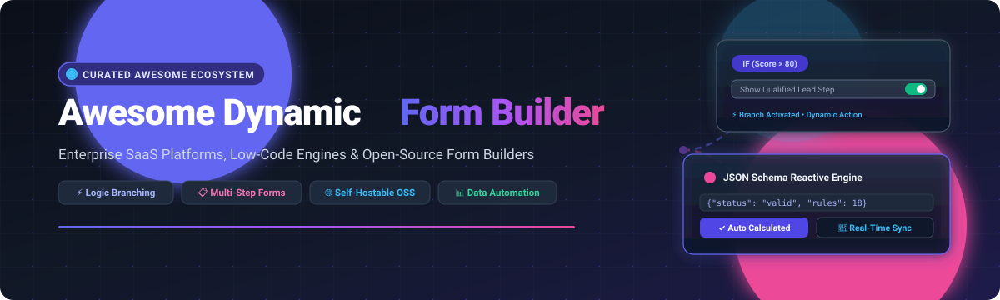

  

# ⚡ Awesome Dynamic Form Builder   

> 🚀 A curated catalog of cutting-edge **SaaS platforms**, **low-code engines**, and **open-source developer libraries** for building intelligent, reactive, logic-driven dynamic form builders.

**Keywords & Topics:** *dynamic form builder, form logic, conditional fields, json schema forms, multi-step forms, survey builder, no-code data collection, self-hosted forms, reactive forms*

---

## 📑 Table of Contents

- [📈 Sector Overview & Market Dynamics](#-sector-overview--market-dynamics)
- [☁️ SaaS / Hosted Platforms](#️-saas--hosted-platforms)
- [💻 Open-Source GitHub Projects](#-open-source-github-projects)
- [🛠️ Architectural Patterns & Best Practices](#️-architectural-patterns--best-practices)
- [🤝 How to Contribute](#-how-to-contribute)
- [⭐ Star History](#-star-history)
- [💖 Support](#-support)
- [⚖️ Disclaimer](#️-disclaimer)

---

## 📈 Sector Overview & Market Dynamics

The global online form builder and digital data collection software market is valued at approximately **$2.5B – $3.2B** (with the broader low-code / digital workflow market exceeding $30B) and is projected to expand at a compound annual growth rate (**CAGR**) of over **14.5%**.

The sector displays a **moderately fragmented** structure: while mega-enterprise CRM giants (such as Salesforce) dominate embedded business records and well-established incumbents (Typeform, Jotform) command widespread brand recognition, specialized segments remain highly dispersed. There is intense and vibrant competition across developer-first API-driven engines, workflow-integrated spreadsheet form tools (Airtable/Baserow), and privacy-focused, self-hosted open-source platforms (Formbricks, HeyForm). As a result, no single player creates a winner-take-all monopoly, leaving significant room for differentiated, niche, and open-source solutions.

---

## ☁️ SaaS / Hosted Platforms

| SaaS Product | Valuation / Revenue Scale | Specific Pricing (Starting Paid Tier) | Free Forever Plan & Limits (or Trial Details) | Key Highlights & Capabilities |
| :--- | :--- | :--- | :--- | :--- |
| **[Salesforce Dynamic Forms](https://www.salesforce.com/)** | ~$280B Market Cap / ~$38B Annual Revenue | From $25/user/month (Starter Suite) | 30-day full-featured free trial (No perpetual free tier) | Native CRM page layout builder; rules-based field visibility, multi-record conditional logic, zero-code admin deployment. |
| **[Typeform](https://www.typeform.com/)** | ~$1B Valuation / ~$100M+ ARR | $25/month (Basic plan, billed annually) | Free forever: 10 responses/month, up to 10 questions per typeform, 1 user seat | Pioneer of conversational one-question-at-a-time forms, dynamic logic branching, calculator variables, rich third-party integrations. |
| **[Jotform](https://www.jotform.com/)** | ~$100M+ Annual Revenue (Bootstrapped) | $34/month (Bronze plan, billed annually) | Free forever: 5 forms, 100 monthly submissions, 100MB storage, 1,000 form views | Massive drag-and-drop form catalog with 10,000+ templates, payment gateway connectors, conditional display logic, and e-signatures. |
| **[Formstack](https://www.formstack.com/)** | ~$50M+ ARR (Acquired by PSG) | $50/month (Starter Forms plan, billed annually) | 14-day full-featured free trial (No perpetual free tier) | Enterprise workflow automation, HIPAA compliance, dynamic conditional field rules, document generation, and digital signature integration. |
| **[Cognito Forms](https://www.cognitoforms.com/)** | ~$10M–$20M ARR (Bootstrapped) | $15/month (Pro plan) | Free forever: 500 entries/month, 1 user seat, 100MB storage, unlimited forms | Powerful calculated expressions, dynamic repeating sections, multi-step page logic, and secure payment processing. |
| **[123FormBuilder](https://www.123formbuilder.com/)** | ~$10M–$15M ARR | $32/month (Gold plan, billed annually) | Free forever: 5 forms, 100 submissions/month, 10 fields per form | Multi-language conditional forms, real-time data sync, payment processors, and custom email notification triggers. |
| **[Paperform](https://paperform.co/)** | ~$5M–$10M ARR | $24/month (Essentials plan, billed annually) | 14-day full-featured free trial (No perpetual free tier) | Document-style aesthetic landing forms, inline mathematical calculations, custom CSS styling, dynamic booking and commerce. |
| **[Wufoo](https://www.wufoo.com/)** | Legacy Category Leader (SurveyMonkey / Momentive) | $14.08/month (Starter plan, billed annually) | Free forever: 5 forms, 100 entries/month, 10 fields per form, 1 user | Established classic form builder featuring field logic branching, automated email notifications, reporting dashboards, and file storage. |
| **[Fillout](https://www.fillout.com/)** | Fast-growing High-Growth VC-backed Startup | $15/month (Starter plan, billed annually) | Free forever: Unlimited forms, 1,000 responses/month, unlimited questions | Seamless two-way dynamic syncing with Airtable, Notion, and Google Sheets; robust conditional logic, multi-page routing, and scheduling. |
| **[Feathery](https://www.feathery.io/)** | High-Growth VC-backed Startup (Seed/Series A) | $49/month (Starter plan) | Free forever: 250 submissions/month, 1 published form, developer SDK access | Developer-first form architecture; complex rules engine, nested conditional branching, headless React SDK, and database connectivity. |

---

## 💻 Open-Source GitHub Projects

Curated open-source form builders, JSON Schema rendering libraries, and visual designers ranked by GitHub Stars:

| Project | Stars | Description & Architecture |
| :--- | :--- | :--- |
| **[Budibase](https://github.com/Budibase/budibase)** |  | Open-source low-code platform (GPL-3.0) with enterprise-grade form generation. Supports schema-driven field generation, multi-step wizards, custom validations, and automatic form creation from PostgreSQL, MySQL, and REST data sources. |
| **[react-jsonschema-form](https://github.com/rjsf-team/react-jsonschema-form)** |  | Standard React component (Apache-2.0) that builds dynamic web forms natively from JSON Schema. Provides official theme support for Material-UI, Ant Design, Bootstrap, Chakra UI, and Fluent UI with custom field widgets and validators. |
| **[Formbricks](https://github.com/formbricks/formbricks)** |  | Leading privacy-first open-source survey and form platform (AGPL-3.0) positioned as an open-source Qualtrics alternative. Features modular question types, targeted in-app/link/email surveys, multi-branch conditional flows, Docker/K8s self-hosting, and webhook/Zapier integrations. |
| **[Formily](https://github.com/alibaba/formily)** |  | Cross-device, high-performance form framework (MIT) by Alibaba. Engineered for complex enterprise form scenarios, supporting JSON Schema dynamic form generation, reactive state management, high performance with hundreds of fields, and bindings for React and Vue. |
| **[form-generator](https://github.com/JakHuang/form-generator)** |  | Visual low-code drag-and-drop Element UI form designer (MIT) generating clean Vue 2/3 and Element component code. Includes live interactive property configuration, responsive previews, and instant code export. |
| **[HeyForm](https://github.com/heyform/heyform)** |  | Open-source conversational form builder (AGPL-3.0) that lets anyone craft beautiful Typeform-like surveys and questionnaires without coding. Includes customizable interactive blocks, logic jumps, custom themes, and submission analytics. |
| **[form-create](https://github.com/xaboy/form-create)** |  | Powerful dynamic form generator (MIT) supporting Vue 2 and Vue 3. Renders high-complexity dynamic forms via JSON rules or visual designer, with support for Ant Design Vue, Element Plus, and Naive UI. |
| **[Baserow](https://github.com/baserow/baserow)** |  | Open-source no-code database platform (MIT) with a built-in interactive Form View. Automatically transforms database tables into public or private forms with dynamic conditional field display, URL pre-filling, file attachments, and custom branding. |
| **[vue-form-making](https://github.com/gavinzhulei/vue-form-making)** |  | Visual drag-and-drop form designer (MIT / Commercial) for Vue.js. Generates dynamic form JSON schemas and production-ready Vue components with custom event handlers and remote data bindings. |
| **[SurveyJS](https://github.com/surveyjs/survey-library)** |  | Versatile open-source JavaScript form and survey library (MIT) with client-side adapters for React, Angular, Vue, and vanilla JS. Renders complex JSON-driven multi-page wizards, dynamic branching, timed tests, dynamic matrices, and PDF export. |
| **[FormKit](https://github.com/formkit/formkit)** |  | Comprehensive form-building framework (MIT) for Vue 3. Features accessible inputs, built-in validation rules, schema-driven form generation, styling integration with Tailwind CSS, and reactive conditional rendering. |
| **[OpnForm](https://github.com/OpnForm/OpnForm)** |  | Beautiful open-source alternative to Typeform and Jotform (AGPL-3.0) built on Laravel 11 and Nuxt 3. Features unlimited form creation, conditional logic, file attachments, e-signature inputs, QR code scanning, Discord/Slack notifications, and self-hosted Docker deployment. |
| **[ohmyform](https://github.com/ohmyform/ohmyform)** |  | Open-source alternative to Typeform and Google Forms (GPL-3.0). Supports creating mobile-responsive, modern conversational forms with custom styling, Docker deployment, and privacy control. |
| **[JSON Forms](https://github.com/eclipsesource/jsonforms)** |  | EclipseSource's customizable JSON Schema-based form framework (MIT). Generates forms dynamically based on data schemas and UI schemas across React, Angular, and Vue with Material, AntD, or custom renderers. |
| **[Form.io Core](https://github.com/formio/formio)** |  | Combined drag-and-drop form builder and API runtime platform (MIT). Automatically renders progressive web application forms while generating corresponding REST APIs for submission data. |
| **[Bootstrap Form Builder](https://github.com/minikomi/Bootstrap-Form-Builder)** |  | Classic web app (MIT) for drag-and-drop creation of responsive Twitter Bootstrap forms, outputting clean HTML snippets. |
| **[variant-form](https://github.com/vform666/variant-form)** |  | Low-code visual form designer and rendering engine for Vue 2 & Vue 3. Features drag-and-drop element placement, live property inspector, dynamic validation schema generation, and full preview modes. |
| **[form-js](https://github.com/bpmn-io/form-js)** |  | Zero-framework visual form builder, renderer, and schema definition library (MIT) by bpmn.io (Camunda). Designed for embedded workflow automation, JSON schema forms, and step-driven user tasks. |
| **[react-reactive-form](https://github.com/bietkul/react-reactive-form)** |  | Angular-inspired reactive forms library (MIT) for React and React Native. Provides fine-grained observable state management, synchronous and asynchronous validation pipelines, and flexible component bindings. |
| **[JSON Schema Form Element](https://github.com/json-schema-form-element/jsfe)** |  | Declarative Custom Web Component `<json-schema-form>` (MIT) that auto-renders dynamic forms from JSON Schema. Completely framework-agnostic, functioning smoothly across Lit, Solid, Vue, React, Svelte, and vanilla HTML. |
| **[Formkl](https://github.com/imrim12/formkl)** |  | Lightweight Domain-Specific Language (DSL) and parser (MIT) that lets developers declare multi-step forms and validation rules using readable natural-language-like syntax. |
| **[pgkiln](https://github.com/pgkiln/pgkiln)** |  | SQL-driven low-code application builder modeled after Oracle APEX for PostgreSQL (MIT). Generates dynamic web forms and data management screens straight from relational database metadata schemas. |

---

## 🛠️ Architectural Patterns & Best Practices

Building dynamic forms typically follows one of three prominent architectural patterns:

1. **Schema-Driven Rendering (JSON Schema / UI Schema):**
   - Projects like `react-jsonschema-form`, `JSON Forms`, and `Formily` decouple data structure from layout presentation.
   - Ideal for developers needing automated validation, internationalization, and dynamic field dependencies via declarative JSON.
2. **Visual Drag-and-Drop Form Composers:**
   - Solutions like `form-generator`, `variant-form`, and `form-create` empower non-developers to compose layouts interactively while outputting clean frontend components.
3. **Full-Stack Self-Hosted Form Engines:**
   - Platforms like `Formbricks`, `HeyForm`, and `OpnForm` provide backend data persistence, end-to-end encryption, multi-tenant workflows, and GDPR-compliant data ownership out-of-the-box.

---

## 🤝 How to Contribute

Contributions are welcome! To propose a new SaaS or open-source tool:

1. 🍴 **Fork** the repository.
2. 🌿 **Create a branch** for your update (`git checkout -b feature/add-new-form-tool`).
3. 📝 **Edit `README.md`**: Follow the established table format. For open-source tools, include the live Shields.io stars badge with `style=social&color=white` linking to the stargazers page. For SaaS, include accurate starting pricing and explicit free tier/trial limits.
4. 🚀 **Submit a Pull Request** with a succinct explanation of why the tool fits the dynamic form ecosystem.

---

## ⭐ Star History

---

## 💖 Support

Thank you for exploring this curated repository! If you find this dynamic form builder index helpful, please consider:
- ⭐ **Starring** the repository on GitHub
- 🍴 **Forking** and contributing your favorite form tools
- 📢 **Sharing** this guide with colleagues, communities, and developer forums
- ☕ Supporting maintenance via the [GitHub Sponsor Dashboard](https://github.com/sponsors/ishandutta2007)

---

## ⚖️ Disclaimer

- This list is community-curated for informational and architectural evaluation purposes.
- Always review security policies, GDPR compliance, and encryption standards before capturing sensitive personal or organizational data through web forms.
